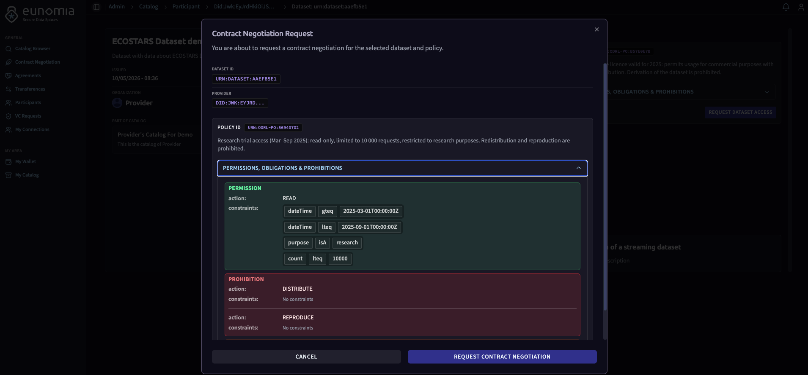
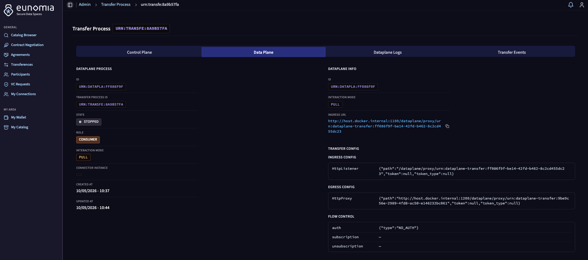
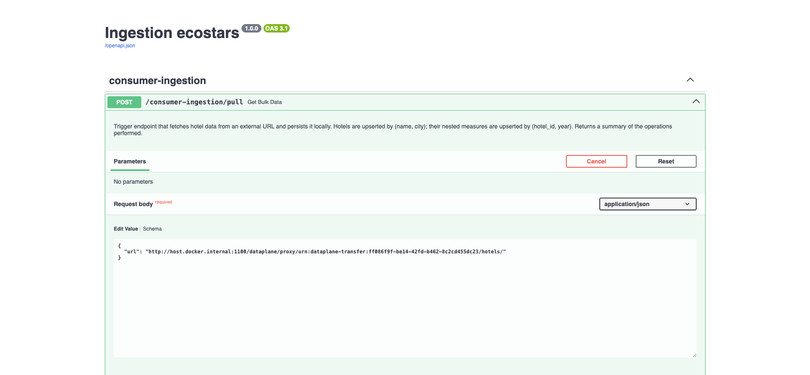
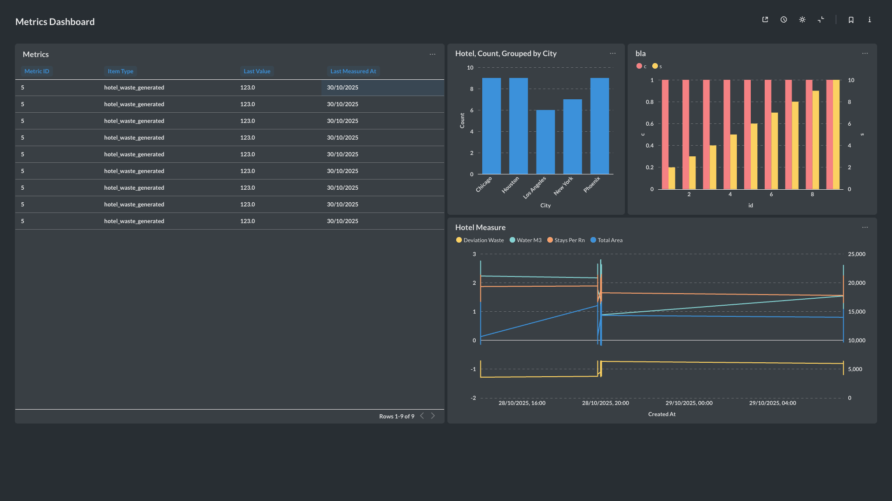
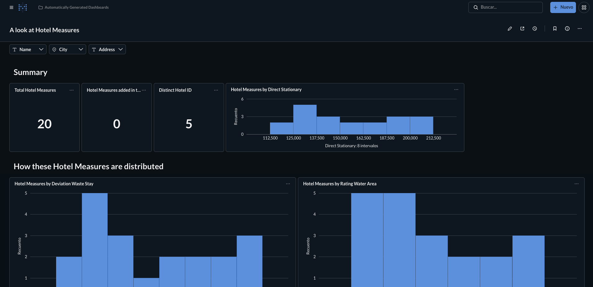

# Ecostars Deployment

[](https://opensource.org/licenses/Apache-2.0)
[](https://www.docker.com/)
[](https://www.python.org/)
[](https://fastapi.tiangolo.com/)
[](https://www.metabase.com/)
[](https://gaia-x.eu/)
[](https://docs.internationaldataspaces.org/ids-knowledgebase/v/dataspace-protocol)

This repository contains the artifacts and tooling to deploy and test the **Ecostars** pilot on top of the **Eunomia** dataspace framework. The pilot models a sustainability-data exchange: the **Provider** is the live ECOSTARS ESDS API publishing hotel sustainability metrics across two use cases - environmental and social - and a **Consumer** ingests them, both as participants of an Eunomia-governed dataspace.

---

## Quick start

```bash
git clone --recurse-submodules https://github.com/EunomiaUPM/eunomia-ecostars-deployment.git
cd eunomia-ecostars-deployment
./eunomia up
./eunomia e2e
```

That's it. About two minutes later (plus the first image pull) you have the authority, both agents and their wallets running, onboarded, with the catalog populated, and an end-to-end test that negotiates a contract and pulls real ECOSTARS data through the dataspace.

`./eunomia up` populates the catalog only if it finds ESDS credentials in `services/provider-final-system/.env` (see [Provider configuration](#provider-configuration)); without them it starts and onboards everything and tells you what is missing.

### What just happened

`up` runs the whole sequence:

1. **Port check** - refuses to start if a non-Docker process holds one of the ports. A natively built agent on the same port silently wins over the container on `127.0.0.1` while the container still looks healthy.
2. **Authority** - Heimdall, its Fafnir wallet and Postgres.
3. **Provider** and **Consumer** - agent, Fafnir wallet, Postgres and Redis each. Every stack is started with `--wait`, then probed from the host.
4. **Onboarding** - links the three wallets, gets both participants a `DataSpaceParticipant` credential from the authority, and completes the consumer↔provider GNAP handshake. Each step checks its outcome.
5. **Catalog** - the two ECOSTARS use cases, see [Catalog structure](#catalog-structure).

Every step is idempotent, so this is also the **update path**:

```bash
git pull
./eunomia up
```

Participants already holding their credential and use cases already in the catalog are left alone. To start over from nothing, `./eunomia down` removes every container, network and volume and the generated identities in `vault/`.

---

## Requirements

- Docker with the Compose plugin (or Docker Desktop)
- Python 3.8+ (standard library only, nothing to install)
- An ECOSTARS ESDS API key, for the catalog and the data pull
- These ports free on the host:

| Port   | Service             | Port   | Service             |
| ------ | ------------------- | ------ | ------------------- |
| `1500` | Heimdall            | `1450` | Heimdall PostgreSQL |
| `1200` | Provider DS-Agent   | `1400` | Provider PostgreSQL |
| `1100` | Consumer DS-Agent   | `1300` | Consumer PostgreSQL |
| `6379` | Provider Redis      | `6380` | Consumer Redis      |
| `8000` | Consumer ingestion¹ | `3000` | Metabase¹           |
| `5440` | Client PostgreSQL¹  |        |                     |

¹ Only with the client stack (`./eunomia up all`).

---

## The `eunomia` CLI

Run it from the repo root as `./eunomia <command>`, or install it with `pip install -e .` to get `eunomia` on your `PATH`. `--help` works on every command.

| Command                                                    | What it does                                                                                                                                                                                                                                        |
| ---------------------------------------------------------- | --------------------------------------------------------------------------------------------------------------------------------------------------------------------------------------------------------------------------------------------------- |
| `eunomia up [node…]`                                       | **Start here.** Starts the stacks, waits for them, onboards and populates the catalog. Nodes: `authority`, `provider`, `consumer`, `client`, `all` (default: the three dataspace nodes). `--no-onboarding`, `--no-catalog`, `--pull`, `--env prod`. |
| `eunomia down`                                             | The inverse of `up` for standalone: containers, networks, volumes and the generated identities in `vault/`, then checks the ports are free. Asks first; `--dry-run`, `--yes`, `--keep-identities`, `--images`, `--client`.                          |
| `eunomia status`                                           | Containers, health and readiness of every node. Exits non-zero if a node is not ready.                                                                                                                                                              |
| `eunomia logs <node> [service…]`                           | Compose logs of one node. `-f`, `--tail`.                                                                                                                                                                                                           |
| `eunomia onboard [wallets\|register [node]\|authenticate]` | Onboarding, whole or one step at a time. Safe to re-run.                                                                                                                                                                                            |
| `eunomia catalog populate`                                 | Creates whatever ECOSTARS use case is missing from the provider catalog. `--force` creates them again.                                                                                                                                              |
| `eunomia catalog show`                                     | Datasets, their distributions and connector instances.                                                                                                                                                                                              |
| `eunomia e2e`                                              | End-to-end test: negotiation, transfer, data pull, suspend/resume, completion. See [End-to-end test](#end-to-end-test).                                                                                                                             |
| `eunomia esds check`                                       | ESDS connectivity on its own: key accepted, anonymous access refused, key issuer matching the host.                                                                                                                                                 |
| `eunomia images [--check]`                                 | Every pinned image and where it is used; `--check` lists newer tags in the registries, without applying them.                                                                                                                                       |
| `eunomia restart <node…>`                                  | Prod: restarts nodes on their servers over SSH. See [Production](#production).                                                                                                                                                                      |
| `eunomia gaia`                                             | GAIA-X credential flow for the consumer. See [GAIA-X compliance](#gaia-x-compliance).                                                                                                                                                               |

Settings come from your shell and from `.env` at the repo root ([`.env.example`](.env.example)). Standalone needs none of them.

---

## End-to-end test

```bash
./eunomia e2e                      # environmental dataset, full lifecycle
./eunomia e2e --dataset social
./eunomia e2e --keep-open          # leave the transfer STARTED and print the proxy URL
./eunomia e2e --list-datasets
```

| Phase       | Steps                                                                                                                |
| ----------- | -------------------------------------------------------------------------------------------------------------------- |
| Discovery   | Participant DIDs, consumer↔provider token, DSP callback address, catalog request                                    |
| Negotiation | `REQUESTED → OFFERED → REQUESTED → OFFERED → ACCEPTED → AGREED → VERIFIED → FINALIZED` → agreement id                |
| Transfer    | `REQUESTED → STARTED` → dataplane address                                                                            |
| Data        | `GET` through the dataplane proxy returns the ESDS hotel list, while the same ESDS URL without a token returns `401` |
| Lifecycle   | `SUSPENDED → STARTED → COMPLETED`                                                                                    |

The state is asserted at every step, so a call that answers `200` with an embedded DSP rejection still fails the test. The data phase is what proves the agreement is enforced end to end: the proxy pull succeeding while an anonymous call to the same upstream is refused means the provider injected the API key server-side and the consumer never saw it.

It checks its preconditions first (agents up, onboarded, catalog populated) and names the missing one. A pass ends with `END-TO-END TEST PASSED` and exit code `0`; `--no-data-pull` validates the protocol alone when the ESDS is unreachable.

---

## Data model

ECOSTARS exposes two independent sustainability datasets. Each covers a time-series of period-level KPIs per hotel, enriched with hotel identity metadata (chain, country, category, coordinates).

| Domain            | Endpoint                  | KPIs                                                                                                                                                             |
| ----------------- | ------------------------- | ---------------------------------------------------------------------------------------------------------------------------------------------------------------- |
| **Environmental** | `GET /esds/environmental` | Energy (kWh), water (m³), waste (kg), CO₂ Scope 1–3 (tCO₂eq), per-room-night ratios and peer benchmarks                                                          |
| **Social**        | `GET /esds/social`        | Gender composition, management gender share, absenteeism, voluntary / involuntary / retirement turnover, gender pay gap, wage inequality ratio, mean hourly wage |

Access to both endpoints requires a **Bearer API key** (`Authorization: Bearer <key>`). The OpenAPI 3.1 contract lives at [`services/provider-final-system/oapi.yaml`](services/provider-final-system/oapi.yaml).

Real-time updates are delivered via a webhook subscription contract:

| Use case      | Subscribe                               | Unsubscribe                                    | Event type                   |
| ------------- | --------------------------------------- | ---------------------------------------------- | ---------------------------- |
| Environmental | `POST /esds/environmental/subscription` | `DELETE /esds/environmental/subscription/{id}` | `esds_environmental_updated` |
| Social        | `POST /esds/social/subscription`        | `DELETE /esds/social/subscription/{id}`        | `esds_social_updated`        |

---

## Architecture

Two layers of components work together: the dataspace infrastructure provided by Eunomia, and the Ecostars-specific services that exercise the pilot.

```text
                          ┌─────────────┐
                          │  Heimdall   │  (Authority / Clearing House)
                          └──────┬──────┘
                                 │
            ┌────────────────────┴────────────────────┐
            │                                         │
    ┌───────▼────────┐                       ┌────────▼────────┐
    │ Provider Agent │  ◄── DSP transfer ──► │ Consumer Agent  │
    └───────┬────────┘                       └────────┬────────┘
            │                                         │
    ┌───────▼────────┐                       ┌────────▼────────┐
    │ ECOSTARS ESDS  │                       │    Consumer     │
    │ API (external) │                       │  (Ingestion)    │
    │  Bearer token  │                       │ FastAPI + PG    │
    └────────────────┘                       └────────┬────────┘
                                                      │
                                              ┌───────▼────────┐
                                              │   Metabase     │
                                              └────────────────┘
```

### Dataspace layer (Eunomia)

- [**Eunomia DS-Agent**](https://github.com/EunomiaUPM/ds-agent): Dataspace Agents that handle core DSP logic for each participant.
- [**Heimdall**](https://github.com/EunomiaUPM/heimdall): Dataspace Authority and Clearing House that governs onboarding and compliance.
- [**Fafnir**](https://github.com/EunomiaUPM/fafnir-wallet): the SSI wallet each of them runs as a sidecar in its own compose file. It custodies keys, signs JWTs and holds the participant's DID and credentials in the participant's database. There is no external wallet service or account.

### Ecostars layer

- **Provider**: The live ECOSTARS ESDS API at `https://api.ecostars.ai` (staging: `https://staging-api.ecostars.ai`). No local mock. Authentication is a static API key, see [Provider configuration](#provider-configuration).
- **Consumer**: A FastAPI ingestion service that persists data into PostgreSQL and exposes it through Metabase. It lives in the [`services/consumer-client-stack/inner`](services/consumer-client-stack/) submodule; start it with `./eunomia up all` (or `./eunomia up client`).

### Images

| Component | Image                                 |
| --------- | ------------------------------------- |
| Heimdall  | `quay.io/eunomia_upm/heimdall:v1.5.0` |
| DS-Agent  | `quay.io/eunomia_upm/ds-agent:v0.4.0` |
| Fafnir    | `rmenendez8/fafnir:v0.2.0`            |
| Databases | `postgres:18`, `redis:8-alpine`       |

All Eunomia images are amd64 only; Docker Desktop runs them under emulation on Apple Silicon. Every tag is pinned: there is no `latest` for `ds-agent`, and the Docker Hub `fafnir` and `heimdall` repositories carry test builds (`v0.3.test`, `v2.2.test`) with no published source. `./eunomia images --check` shows what is newer.

---

## Provider configuration

The ESDS base URL and API key live in `services/provider-final-system/.env` (template: [`.env.template`](services/provider-final-system/.env.template)):

```dotenv
API=https://staging-api.ecostars.ai/esds
API_KEY=<your-ecostars-api-key>
```

That file is not tracked by git, so each machine needs its own; copy the template and fill in the key. `ESDS_API` and `ESDS_API_KEY` in your shell override it. Check them before populating the catalog:

```bash
./eunomia esds check
```

> [!WARNING]
> A staging key against the production host answers `401` exactly like a revoked key. `esds check` compares the key's issuer with the host and warns when they disagree.

---

## Catalog structure

The catalog is organised around two independent use cases that share the same connector templates.

```text
Catalog
├── Dataset: ECOSTARS Environmental Sustainability
│   ├── Distribution: Environmental - HTTP Pull  (GET /esds/environmental)
│   └── Distribution: Environmental - HTTP Push  (esds_environmental_updated)
├── Dataset: ECOSTARS Social Sustainability
│   ├── Distribution: Social - HTTP Pull          (GET /esds/social)
│   └── Distribution: Social - HTTP Push          (esds_social_updated)
├── Policies (per dataset)
│   ├── Policy: template instantiation (time-limited research access for UPM)
│   ├── Policy: commercial use with attribution (2026)
│   └── Policy: research trial, read-only, 10 000 req limit (Mar–Sep 2026)
├── Connector Template: HTTP Pull  (BEARER_TOKEN)
├── Connector Template: HTTP Push  (BEARER_TOKEN, parameterised EVENT_TYPE)
└── Connector Instances
    ├── pull-environmental  → /esds/environmental
    ├── pull-social         → /esds/social
    ├── push-environmental  → /esds/environmental/subscription
    └── push-social         → /esds/social/subscription
```

The push connector templates use a single `SUB_URL` parameter for both subscribe and unsubscribe: subscribe issues `POST <SUB_URL>` and unsubscribe issues `DELETE <SUB_URL>/{id}`, where `{id}` is extracted at runtime from the subscription creation response.

Raw JSON payloads for every catalog object live in [`static/catalog/`](static/catalog/). `eunomia catalog populate` fills in their `__PLACEHOLDERS__` with the ids the provider returns and the ESDS credentials.

---

## Usage

### Contract negotiation and data transfer from the UI

`./eunomia e2e` drives the whole flow from the command line. To do it by hand, use the Eunomia DS-Agent UI:

| Agent    | URL                                 | Login                 |
| -------- | ----------------------------------- | --------------------- |
| Provider | `http://127.0.0.1:1200/admin/login` | `eunomia` / `eunomia` |
| Consumer | `http://127.0.0.1:1100/admin/login` | `eunomia` / `eunomia` |



After negotiation, trigger a transfer to move data through the dataplane:



### Consumer ingestion endpoints

The ingestion service ([`services/consumer-client-stack/`](services/consumer-client-stack/)) exposes two endpoints:

**`POST /consumer-ingestion/pull`** - on-demand bulk fetch. Calls the given URL and upserts the returned hotels and KPI records into the database:

```json
{ "url": "https://staging-api.ecostars.ai/esds/environmental" }
```

**`POST /consumer-ingestion/push`** - webhook for real-time KPI updates, called by the ECOSTARS ESDS API whenever data changes. The payload is an event envelope carrying the updated hotel record:

```json
{
  "event_type": "esds_environmental_updated",
  "occurred_at": "2026-05-17T11:00:00Z",
  "data": {
    "hotel_uuid": "1756fe72-97ad-4a62-8c79-835a77725b7f",
    "hotel_name": "Molino de Saydo",
    "values": [
      {
        "uuid": "...",
        "periodicity": "year",
        "period": "[2023-01-01,2024-01-01)",
        "energyTotalKwh": 314159.0
      }
    ]
  }
}
```



> [!IMPORTANT]
> The dataplane proxy forwards the caller's `User-Agent` to the ESDS, and its Cloudflare zone bans generic client ones such as Python's `urllib` and `python-requests` (`403`, error `1010 browser_signature_banned`). Anything pulling through the proxy must send its own `User-Agent`.

### Metabase dashboards

The Metabase dashboard queries the transactional database directly and provides charts for hotel counts, KPI measures, and metric time series:





| Service           | URL                          |
| ----------------- | ---------------------------- |
| Ingestion Service | `http://localhost:8000`      |
| Swagger UI        | `http://localhost:8000/docs` |
| Metabase          | `http://localhost:3000`      |
| PostgreSQL        | `localhost:5440`             |

---

## Deployments

| Environment  | Where                                              | What it is                                                                                          |
| ------------ | -------------------------------------------------- | --------------------------------------------------------------------------------------------------- |
| `standalone` | [`deployment/standalone/`](deployment/standalone/) | All three participants on one host, fake vault, `did:jwk`. The default for every `eunomia` command. |
| `prod`       | [`deployment/prod/`](deployment/prod/README.md)    | One participant per server, HashiCorp Vault, TLS, `did:web` on a domain.                            |

### Production

Follow [`deployment/prod/README.md`](deployment/prod/README.md) to prepare each server. Then, on each one:

```bash
./eunomia up authority --env prod     # on the authority server, first
./eunomia up provider  --env prod     # on the provider server
./eunomia up consumer  --env prod     # on the consumer server
```

Onboarding and the catalog span servers, so run them once every node is up, from any machine that reaches the three public URLs (`AUTHORITY_URL`, `PROVIDER_URL`, `CONSUMER_URL` in `.env`):

```bash
./eunomia onboard --env prod
./eunomia catalog populate --env prod
./eunomia e2e --env prod
```

`./eunomia restart <node…>` restarts nodes on their servers over SSH, using the `<NODE>_SSH_*` settings in `.env`. It recreates only the agent and its wallet: the databases have no volume. Restarting `client` wipes the client stack (`down -v`) and asks first. [`.github/workflows/deploy.yml`](.github/workflows/deploy.yml) deploys prod when you start it from the Actions tab (it does not run on push yet); see [`deployment/AUTOMATED-DEPLOYMENT.md`](deployment/AUTOMATED-DEPLOYMENT.md).

---

## Configuration

### DID method

Depending on the environment, the Decentralized Identifier (DID) method changes. While **GAIA-X officially only supports `did:web`**, Eunomia allows flexibility for local testing:

- **Standalone**: uses **`did:jwk`**. `did:web` needs a public domain, and with a port in it the DID is stored with a literal `%3A` that the UI cannot look up.
- **Production**: uses **`did:web`** to remain compliant with GAIA-X standards.

> [!TIP]
> Heimdall is designed to work as a Clearing House using `did:jwk` in standalone mode, allowing you to test the full compliance flow without DNS or web server setup.

---

## GAIA-X Compliance

By default, Eunomia operates in a generic dataspace mode. To make the deployment **GAIA-X compliant**, apply the following three changes to **both** the Provider Agent and the Consumer Agent.

### 1 - Verification configuration

In each Agent config YAML, update the `verify_req_config` block to require a GAIA-X Label Credential:

```yaml
verify_req_config:
  is_cert_allowed: false
  vcs_requested: [gx:LabelCredential]
```

### 2 - GAIA-X connectivity

Add (or update) the `gaia_config` block pointing to the Heimdall instance:

```yaml
gaia_config:
  api:
    protocol: "http" # standalone: http | prod: https
    url: "url" # standalone: host.docker.internal | prod: your.domain.com
    port: null # standalone: 1500 (Heimdall port) | prod: null
```

### 3 - Heimdall startup command

In [`docker-compose.standalone.heimdall.yaml`](deployment/standalone/docker-compose.standalone.heimdall.yaml), change the config file in the `command` of both the `heimdall` and `heimdall-setup` services to the EcoAuthority one:

```yaml
command:
  - setup # start for the heimdall service
  - --env-file
  - /app/static/config/standalone.eco_authority.yaml
```

Prod already runs [`eco_authority.yaml`](static/config/heimdall/prod/eco_authority.yaml).

Then redeploy from scratch (`./eunomia down && ./eunomia up`) and run the consumer's credential flow with `./eunomia gaia`.

> [!NOTE]
> The EcoAuthority config activates **all** Heimdall roles simultaneously: GAIA-X Clearing House, Clearing House Proxy, Legal Authority, and Dataspace Authority. In a real-world ecosystem a single entity should not assume all these roles - this multi-role configuration is strictly for **development and testing**.

---

## Troubleshooting

| Symptom                                                                           | Cause                                                                                                                                                       |
| --------------------------------------------------------------------------------- | ----------------------------------------------------------------------------------------------------------------------------------------------------------- |
| `404` with `error_code 3200`, or an empty reply, from an agent that looks healthy | A native `monolith` or `heimdall` binary listening on the same port. `up` refuses to start when it sees one; `lsof -nP -iTCP:<port> -sTCP:LISTEN` shows it. |
| `502` from the consumer UI on any DSP call                                        | The consumer holds no token for the provider: the GNAP handshake never completed. `./eunomia onboard authenticate`.                                         |
| `401` from the ESDS with a key that worked before                                 | Staging key against the production host, or the other way round. `./eunomia esds check`.                                                                    |
| `403` with error `1010` through the dataplane proxy                               | Cloudflare banned the forwarded `User-Agent`. Send a custom one.                                                                                            |
